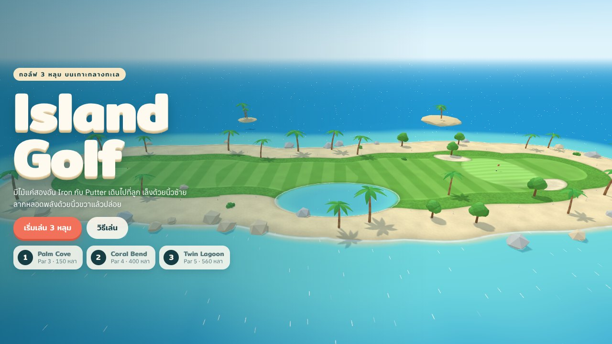
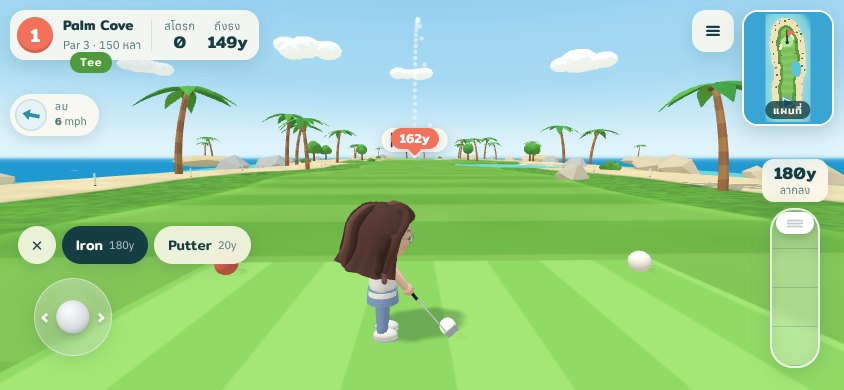
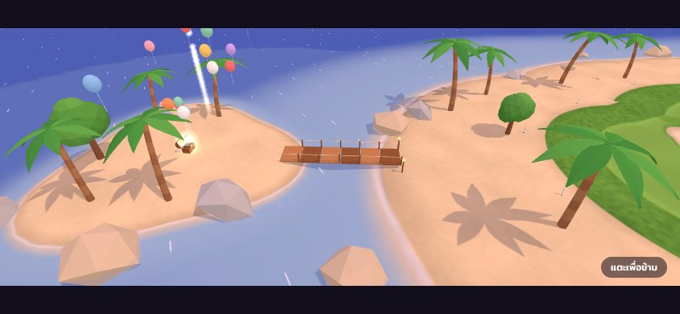
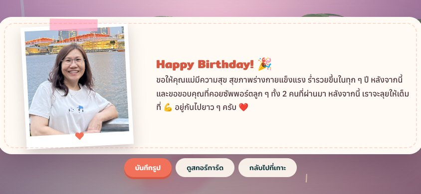
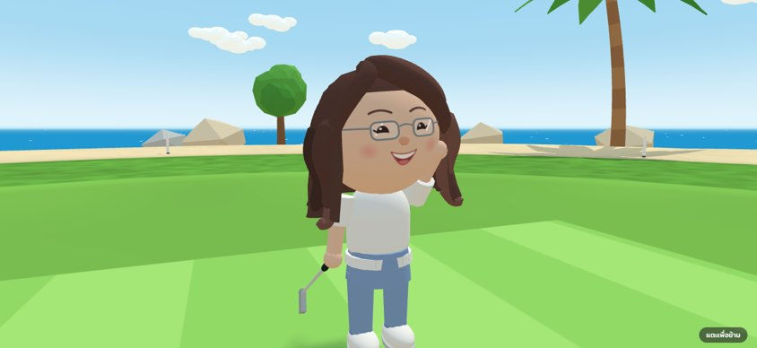
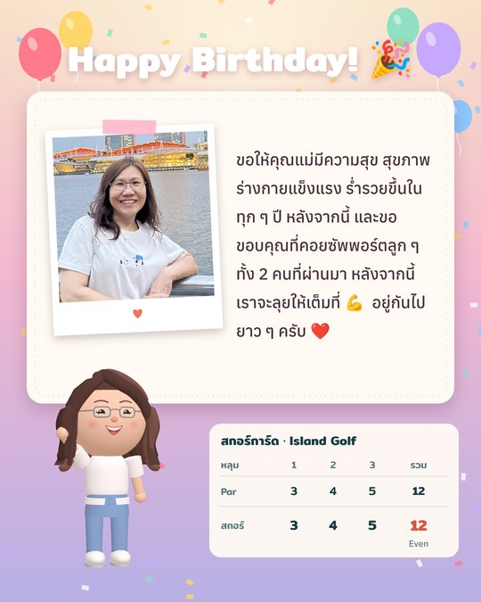

# Island Golf 🏝️⛳

เกมกอล์ฟ 3 มิติบนเกาะ low-poly เล่นบนเว็บได้ทั้งมือถือและคอม 3 หลุม (Par 3 · Par 4 · Par 5) จบด้วยฉากอวยพรวันเกิดคุณแม่: สะพานไปเกาะของขวัญเปิด หีบเปิด จดหมายพร้อมรูป พลุ ลูกโป่ง และปุ่มบันทึกรูปที่ระลึก



| ท่าตีบนมือถือ | สะพานไปเกาะของขวัญ | จดหมายวันเกิด |
|---|---|---|
|  |  |  |

| ฉากเปิดหลุม | รูปที่ระลึกจากปุ่มบันทึกรูป | โมเดลตัวละคร |
|---|---|---|
|  |  |  |

## เล่นเลย

ไฟล์ที่เล่นได้อยู่ใน `dist/` เป็น HTML ไฟล์เดียว ไม่ต้องติดตั้งอะไร

- `dist/island-golf.html` ตัวเกม
- `dist/mom-avatar.html` หน้าดูโมเดลตัวละครแบบหมุนได้รอบตัว

เปิดด้วยเบราว์เซอร์ได้เลย (ต้องต่อเน็ต เพราะโหลด three.js และฟอนต์จาก CDN)

### ติดตั้งเป็นแอปบน iPhone

เล่นผ่านแอปจะไม่มีแถบเบราว์เซอร์มาบังจอ จอไม่ซูมหรือเด้ง และเปิดได้แม้ไม่มีเน็ต (หลังจากเปิดครั้งแรกไปแล้ว)

1. เปิดลิงก์เกมด้วย **Safari** (ต้องเป็น Safari เท่านั้น)
2. รอให้เกมโหลดจนเห็นหน้าแรก
3. กดปุ่ม **แชร์** (สี่เหลี่ยมมีลูกศรชี้ขึ้น) → **เพิ่มไปยังหน้าจอโฮม** (Add to Home Screen) → **เพิ่ม**
4. เปิดเกมจากไอคอน Island Golf บนหน้าจอโฮม แล้วหมุนเครื่องเป็นแนวนอน

ตอนกดบันทึกรูปที่ระลึก เครื่องจะเปิดหน้าแชร์ขึ้นมา ให้เลือก **บันทึกรูปภาพ** รูปจะเข้าไปอยู่ในแอปรูปภาพ

Android: เปิดด้วย Chrome → เมนู ⋮ → **ติดตั้งแอป** หรือ **เพิ่มลงในหน้าจอหลัก**

### Push ขึ้น GitHub

สร้าง repo ว่างบน GitHub ก่อน (ไม่ต้องติ๊ก README) แล้วรันในโฟลเดอร์นี้

```bash
git init
git add .
git commit -m "Island Golf"
git branch -M main
git remote add origin https://github.com/<username>/<repo>.git
git push -u origin main
```

### ขึ้น GitHub Pages

1. Push repo นี้ขึ้น GitHub (ต้อง commit โฟลเดอร์ `dist/` ด้วย ซึ่ง `.gitignore` ไม่ได้กันไว้)
2. ไปที่ **Settings → Pages** เลือก **Deploy from a branch** → branch `main` → โฟลเดอร์ `/ (root)`
3. รอสักครู่ แล้วเปิด `https://<username>.github.io/<repo>/` หน้า `index.html` ที่ root จะพาไปที่ตัวเกมเอง

### ขึ้น Vercel

มี `vercel.json` ตั้งค่าไว้แล้ว ไม่ต้องแก้อะไรใน Project Settings

- ลากทั้งโฟลเดอร์ไปวางที่ Vercel หรือ import repo จาก GitHub ก็ได้
- Vercel จะรัน `build.py` ใหม่ แล้วเสิร์ฟโฟลเดอร์ `dist/` (ถ้าเครื่อง build ไม่มี Python จะใช้ไฟล์ใน `dist/` ที่ build ไว้แล้ว)
- หน้าแรก `/` คือตัวเกม ส่วน `/mom-avatar.html` คือหน้าโมเดลตัวละคร

## โครงสร้างโปรเจกต์

```
island-golf/
├── index.html            หน้า redirect ไป dist/island-golf.html (สำหรับ GitHub Pages)
├── vercel.json           ตั้งค่าสำหรับ Vercel (build แล้วเสิร์ฟ dist/)
├── pwa/                  ไฟล์สำหรับติดตั้งเป็นแอป: manifest.webmanifest, sw.js (ใช้งานออฟไลน์)
├── tools/make_icons.py   สร้างไอคอนแอปใน assets/icons/
├── index.src.html        HTML + CSS ทั้งหมดของเกม (มีจุดวางสคริปต์ /*__GAME__*/)
├── studio.src.html       หน้า preview ตัวละคร
├── build.py              รวม src/*.js + รูป → dist/island-golf.html
├── build_studio.py       รวม core + character + studio → dist/mom-avatar.html
├── src/
│   ├── config.js         ✏️ ข้อความอวยพร ชื่อไฟล์รูปที่บันทึก (แก้ตรงนี้)
│   ├── core.js           ค่าคงที่ ข้อมูลหลุม โซนสนาม ความสูงพื้น เนินกรีน
│   ├── world.js          ฉาก 3D: ท้องฟ้า น้ำ พื้นสนาม (shader) ต้นไม้ หิน เกาะของขวัญ พลุ
│   ├── character.js      ตัวละครคุณแม่ (ปั้นด้วย geometry ล้วน ไม่ใช้รูปถ่าย) + ท่าเดิน/ตี/โบกมือ
│   ├── ui.js             จอยสติ๊ก หลอดพลัง แผนที่ สกอร์การ์ด จดหมาย สร้างรูปที่ระลึก
│   ├── main.js           game loop ฟิสิกส์ลูก ลม กล้อง ฉากจบ เสียง
│   └── studio.js         หน้าหมุนดูโมเดล
├── assets/
│   ├── letter_photo.jpg  ✏️ รูปคุณแม่ในจดหมาย (ฝังลงไฟล์ตอน build)
│   └── icons/            ไอคอนแอปบนหน้าจอโฮม
├── dist/                 ไฟล์ที่ build แล้ว พร้อมเล่น (หน้าเกม หน้าโมเดล manifest service worker ไอคอน)
├── docs/
│   ├── REQUIREMENTS.md   ความต้องการและกติกาทั้งหมด
│   └── screenshots/
└── test/                 ทดสอบอัตโนมัติด้วย Playwright
```

## แก้ข้อความหรือรูป

1. ข้อความอวยพร: แก้ใน `src/config.js`
2. รูปในจดหมาย: แทนที่ `assets/letter_photo.jpg` (แนะนำรูปแนวตั้งหรือจัตุรัส กว้างราว 640px)
3. Build ใหม่: `python3 build.py`

## Build

ต้องมี Python 3 (ไม่ต้องลงแพ็กเกจเพิ่ม)

```bash
python3 build.py          # → dist/island-golf.html + manifest, sw.js, icons
python3 build_studio.py   # → dist/mom-avatar.html
# หรือ
npm run build
```

ระหว่างพัฒนา เปิด local server แล้วเข้า `http://localhost:8000/dist/island-golf.html`

```bash
python3 -m http.server 8000
```

### Build สำหรับ Claude Artifact

Claude Artifact ห่อหน้าเว็บด้วย `<html><head><body>` ให้เอง จึงต้องใช้ไฟล์แบบ fragment:

```bash
python3 build.py --fragment   # → build/island-golf.html (ไม่ commit)
```

## ทดสอบ

เทสต์รันเกมจริงใน Chromium แบบ headless แบบออฟไลน์ (เสิร์ฟ three.js และฟอนต์จาก `node_modules`) ไม่ต้องใช้ในการเล่น ใช้เฉพาะตอนแก้โค้ด

```bash
npm install
pip install -r test/requirements.txt
python3 -m playwright install chromium
python3 build.py && python3 build_studio.py
python3 test/run_all.py
```

| ไฟล์ | ตรวจอะไร |
|---|---|
| `smoke_test.py` | โหลดหน้าได้ เริ่มหลุมได้ Iron 100% ไปได้ราว 180 หลา ปุ่มเล็งอยู่ฝั่งซ้าย |
| `app_test.py` | ติดตั้งเป็นแอปได้ (manifest, ไอคอน) จอไม่ซูม/เด้งบนมือถือ เรนเดอร์แบบเบาบนมือถือ เปิดออฟไลน์ได้ |
| `intro_test.py` | ฉากเปิดหลุม: มุมสูง → กล้องลงมาหน้าตัวละคร → หมุนไปด้านหลัง แตะเพื่อข้ามได้ |
| `bot_playthrough.py` | บอทตีครบ 3 หลุมภายใต้ลมสุ่มและกรีนที่มีเนิน |
| `finale_test.py` | ลงหลุม 3 → ฉากเปิดสะพาน → เดินถึงหีบแล้วจดหมายเปิดเอง → บันทึกรูป → ดาวน์โหลด |
| `studio_test.py` | หน้าโมเดลตัวละครเรนเดอร์ได้ทุกมุม |

ภาพหน้าจอจากเทสต์อยู่ที่ `test/out/` เกมเปิด `window.__golf` ไว้ให้เทสต์ควบคุม loop ได้ (freeze, step, shoot, startRound, skipIntro ฯลฯ)

## เทคโนโลยี

- [three.js](https://threejs.org/) r160 (UMD จาก jsDelivr) ไม่มี bundler ไม่มี framework
- ฟอนต์ Mitr + Anuphan จาก Google Fonts
- พื้นสนามแบ่งโซน (Fairway / Rough / Green / Bunker / น้ำ) ต่อพิกเซลใน shader และฝั่ง JS ใช้สูตรเดียวกันเช็กว่าลูกตกโซนไหน
- เสียงสังเคราะห์ด้วย Web Audio (รวมเพลง Happy Birthday)
- ปุ่มบันทึกรูป: ใน Claude ใช้ downloads capability นอก Claude ใช้การดาวน์โหลดปกติของเบราว์เซอร์

## ความเป็นส่วนตัว

`assets/letter_photo.jpg` และไฟล์ใน `dist/` มีรูปคุณแม่ฝังอยู่ ถ้าตั้ง repo เป็น Public ทุกคนที่เข้า repo หรือเว็บจะเห็นรูปนี้ ถ้าไม่ต้องการ ให้ตั้ง repo เป็น Private หรือเปลี่ยนรูปก่อน push
